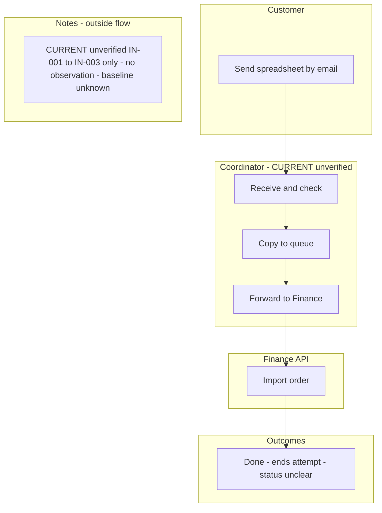
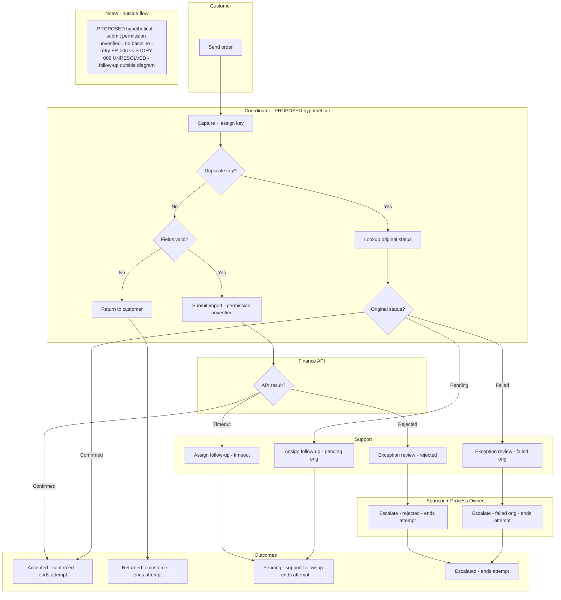

# Beacon Order Intake v4 - one intake attempt

Boundary: one intake attempt from customer send to first recorded disposition. Terminals: Accepted (only after confirmed Finance API status), Returned to customer, Pending with support follow-up, Escalated to sponsor/process owner. Correction, status check, or authorized retry is a separate follow-up process outside this diagram. CURRENT is unverified. PROPOSED is hypothetical.

### CURRENT - Manual email to finance (unverified)

### PROPOSED - Idempotent intake - one attempt (hypothetical)

Evidence and decisions outside flow: CURRENT from synthetic IN-001 to IN-003 only, no observation or baseline. PROPOSED hypothetical, Finance API submit permission unverified, no owner approval. Retry ownership FR-006 vs STORY-006 UNRESOLVED pending sponsor/process-owner decision; no retry assigned to coordinator or support. Retries reuse same key only if authorized in separate follow-up.

| Step | Actor | Next |
| --- | --- | --- |
| Send order | Customer | Capture + assign key |
| Capture + assign key | Coordinator | Duplicate key? |
| Duplicate key? Yes / No | Coordinator | Yes: Lookup / No: Fields valid? |
| Lookup original status | Coordinator | Original status? |
| Original status? Confirmed / Pending / Failed | Coordinator | Confirmed: Accepted / Pending: Assign follow-up / Failed: Exception review |
| Fields valid? Yes / No | Coordinator | No: Return to customer / Yes: Submit import |
| Return to customer | Coordinator | Returned terminal |
| Submit import - permission unverified | Coordinator | API result? |
| API result? Confirmed / Rejected / Timeout | Finance API | Confirmed: Accepted / Rejected: Exception review / Timeout: Assign follow-up |
| Assign follow-up | Support | Pending terminal |
| Exception review | Support | Escalate |
| Escalate | Sponsor + Process Owner | Escalated terminal |

| Check | Result |
| --- | --- |
| One start, four PROPOSED terminals: Accepted, Returned, Pending, Escalated | Pass |
| Duplicate Confirmed to Accepted; Pending to Pending via Support; Failed to Escalated | Pass |
| New valid to API; Confirmed to Accepted; Rejected to Escalated; Timeout to Pending | Pass |
| Invalid to Returned terminal; no outcome routed back to work, no unbounded loop | Pass |
| CURRENT single path to Done terminal, marked unverified IN-001 to IN-003 | Pass |
| No retry assigned; FR-006 vs STORY-006 UNRESOLVED in note only | Pass |
